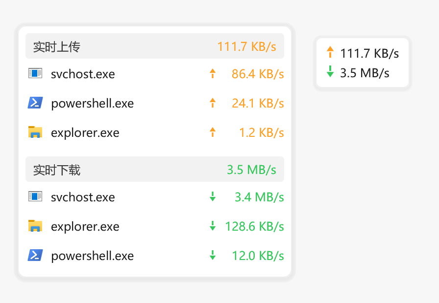
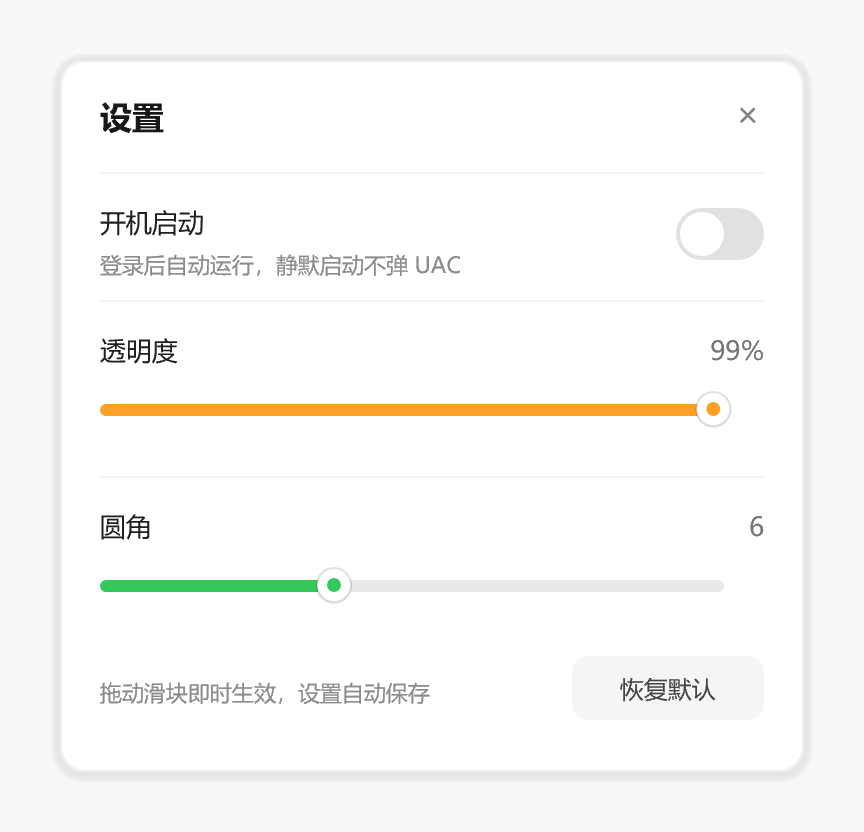

# FlowDock · 流量浮窗

Windows 上的轻量流量悬浮窗：一张常驻小卡片显示实时上行/下行，鼠标悬停展开
「实时上传 / 实时下载」的进程榜（带真实进程图标）；拖到屏幕左右边缘变成贴边竖条，
悬停会展开成完整卡片。视觉参考火绒安全的流量悬浮窗，代码、图标、采集全部自研。



<p align="center">
  
  &nbsp;&nbsp;&nbsp;
  
</p>

## 当前状态（检查点 4）

- 无边框、圆角、软阴影的分层窗口（per-pixel alpha + `UpdateLayeredWindow`）
- 卡片：`↑ 上行 / ↓ 下行`，橙/绿双色，每秒刷新，圆角 0–16 可调
- 拖动移动；距屏幕边缘 20px 内松手吸附
- **贴边竖条**：16×48，上下两段虚线（上段=上传橙、下段=下载绿），每段只有当前档位
  那一格上色；鼠标移上去展开成完整卡片（约 120ms 补间），点一下钉住，再点取消，
  往屏幕内拖 24px 退出吸附
- **悬停面板**：实时上传 / 实时下载各 Top 3，真实进程图标（`SHGetFileInfo` 取 32×32
  转预乘 BGRA 缓存），固定贴在卡片左上方
- **逐进程采集走 ETW**（`Microsoft-Windows-Kernel-Network`）：事件 10/11（TCP v4）、
  26/27（TCP v6）、16/17（UDP）的 payload 前 8 字节是 `PID + size`；
  实测回环传输 52 MB，累计字节 51.4 MB / 52.0 MB
- **总量与榜单一致**：有 ETW 时卡片总量取各进程之和，ETW 不可用时退回网卡计数器
  （只统计物理网卡，避免 VPN / 虚拟网卡把同一份流量重复相加）
- **设置面板**（右键悬浮窗/托盘 →「设置…」，或 `--settings`）：开机启动（计划任务，
  最高权限静默启动）、透明度、圆角、恢复默认，整行可点、行悬停高亮
- 单实例：第二次启动会把 `--settings` 转发给已运行实例，然后自己退出
- 全部 Direct2D + DirectWrite **软件渲染**（`D2D1_RENDER_TARGET_TYPE_SOFTWARE`）

仍然没有的：点击进程行的动作、历史流量统计。

> 截图里的进程名（svchost / powershell / explorer）和速率是 `FLOWDOCK_DEMO=1` 下的假数据，
> 由 `flowdock.exe --shot <dir> [scale]` 离线渲染，不经过桌面，也不包含任何真实使用记录。

## 实测资源占用

| 指标 | FlowDock | 火绒 HipsTray（同机器实测） |
|---|---|---|
| 工作集 | 22.5 MB | 45.8 MB |
| 私有内存 | 10.7 MB | 18.8 MB |
| exe 体积 | 366 KB | 3.2 MB |

Direct2D 的 DC 渲染目标默认会走硬件路径，单是它就要 30 MB 以上；显式指定
`SOFTWARE` 之后降到 20 MB 出头。这一行不能删。

## 构建与运行

```powershell
cargo build --release
.\target\release\flowdock.exe
.\target\release\flowdock.exe --settings   # 直接打开设置面板
```

需要 MSVC 工具链（`rustc` host 为 `x86_64-pc-windows-msvc`），以及**管理员权限**
（ETW 内核网络会话需要提权；没有权限时会自动退回网卡总量，进程榜为空）。

## 配置

`%APPDATA%\FlowDock\config.json`

```json
{
  "x": 1812,
  "y": 237,
  "radius": 6.0,
  "opacity": 252,
  "autostart": false,
  "dock": "Right"
}
```

`dock` 取 `None` / `Left` / `Right`。开机自启对应计划任务 `FlowDock`，关闭时删除。

## 结构

```
src/main.rs   三个窗口的生命周期、悬停状态机、贴边逻辑、设置交互、托盘、单实例
src/gfx.rs    Direct2D/DirectWrite 封装（软件渲染、圆角、圆、箭头、图标位图、文字测量）
src/ui.rs     卡片/面板/竖条/设置面板的布局与绘制，以及命中测试
src/etw.rs    ETW 实时会话：StartTrace + EnableTraceEx2 + ProcessTrace 回调累计字节
src/net.rs    采样线程：ETW 增量、进程名/路径、系统总量兜底
src/icon.rs   进程图标提取与缓存
src/win32.rs  分层表面、像素 alpha、工作区定位
src/tray.rs   运行时绘制的托盘图标
src/config.rs 配置读写 + 计划任务
```

## 已知限制

- **DPI / 多显示器**：窗口尺寸在启动时按主屏 DPI 算好，拖到 125%/150% 的显示器上不会重算
- **代理 / TUN 模式**：只能统计走 TCP/IP 栈的流量；Clash 这类 TUN 代理的真实外网段看不到，
  面板里显示的是「应用 ↔ 代理」那一段（数字本身准确，只是口径）
- **ETW 会话被外部停止**（比如别的工具 kill 掉同名会话）后不会自动重连，需要重启程序
- 设置面板不支持键盘（Esc 关闭），只能点 ×

## 下一步

1. 点击进程行：打开文件位置 / 结束进程
2. 历史流量（日/周）统计

## 许可证

[MIT](LICENSE)

